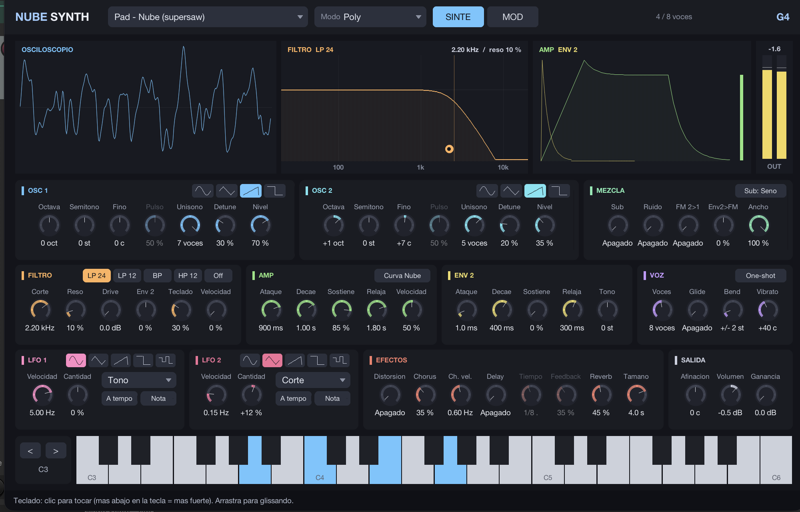
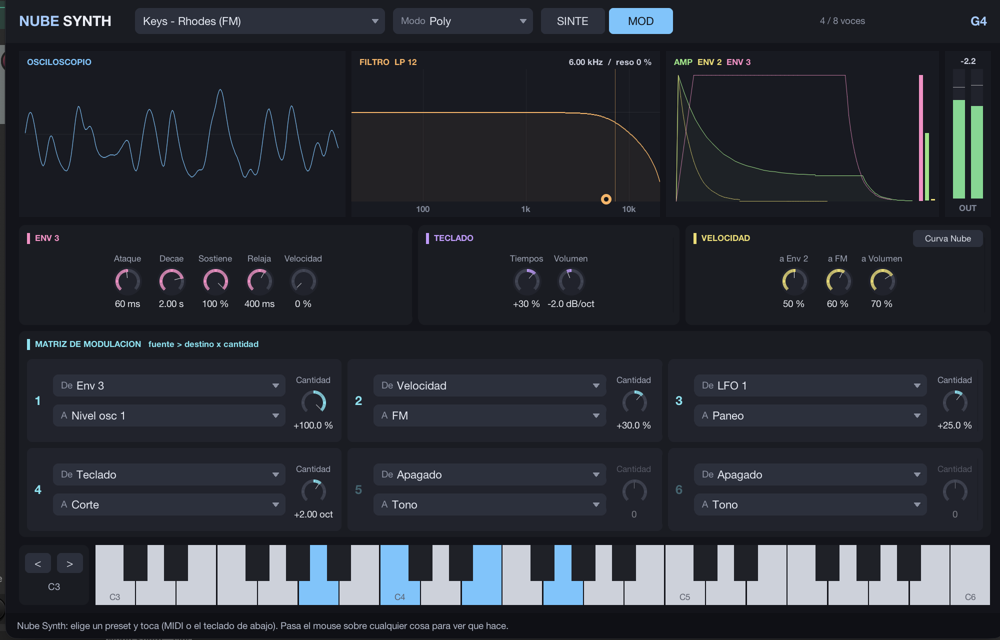

<!-- en -->
# Nube Synth

A free polyphonic synthesizer (instrument) for [REAPER](https://www.reaper.fm), written as a JSFX (macOS / Windows / Linux), part of the
[Nube plugins](https://github.com/KevinMeneses/nube-plugins).



2 anti-aliased oscillators (4-point polyBLEP) with up to 7-voice unison, sub, noise and FM; 24/12 dB low-pass, band-pass and high-pass filter with resonance and drive; amp + 2 mod envelopes; 2 tempo-syncable LFOs with 7 destinations; a 6-slot modulation matrix (Env 2/3, LFOs, velocity, keyboard, mod wheel → pitch, cutoff, FM, per-oscillator level, pulse width, pan, volume); keyboard → envelope times and volume, velocity → FM and envelope amounts, an RS5k-style velocity curve, one-shot mode and up to +24 dB output gain; poly / mono / legato with glide (808 slides), pitch bend, mod wheel, sustain pedal; distortion, Juno-style chorus, ping-pong delay and reverb; on-screen keyboard and a library of 119 level-matched presets.

**1.2** brings the preset library: 119 sounds in 11 categories (808 and sub, basses, plucks, keys, pads, strings and winds, leads, bells and mallets, arps, textures, FX), all at the same loudness, with previous / next buttons. Existing projects still render identical to 1.0, sample by sample (`tests/compat.sh`).

**1.1** added the modulation page without changing anything that was there: every 1.0 slider keeps its number and meaning (the new ones come after them).

**Install** — with [ReaPack](https://reapack.com): *Extensions → ReaPack → Import repositories*, paste
`https://github.com/KevinMeneses/nube-plugins/raw/main/index.xml`, then install **Nube Synth**. Or copy `nube_synth.jsfx`
into `REAPER/Effects/Nube Synth/` (on macOS `./install.sh` links it). It shows up as **JS: Nube Synth**. The interface is in Spanish.

**How it was made** — designed and built with [Claude Code](https://claude.com/claude-code). Since an AI can't
listen, every feature is verified by rendering test cases inside REAPER and comparing them with the theory
(`tests/run.sh`), plus mouse-driven UI tests (`tests/ui_test.py`).

**License** — GPL-3.0-or-later (see `LICENSE`).

---

## Español
Sintetizador para REAPER (JSFX instrumento, macOS/Windows/Linux), hermano de [Nube EQ](https://github.com/KevinMeneses/nube-eq), Nube Comp, Nube Verb,
Nube Delay y los demás Nube.




- **2 osciladores** (Seno, Triángulo, Sierra, Pulso con ancho) con antialiasing polyBLEP de 4 puntos (sierra en C7:
  −33 dB de aliasing, 22 dB mejor que una sierra ingenua), octava, semitono, fino, **unísono hasta 7** con detune y
  ancho estéreo, **sub** (seno o cuadrada), **ruido** y **FM** (osc 2 modula la fase del osc 1, también por envolvente).
- **Filtro** SVF trapezoidal: pasa-bajos 24 / 12 dB, pasa-banda, pasa-altos, apagado; resonancia (casi auto-oscila),
  drive, envolvente 2, seguimiento de teclado y velocidad.
- **Amp**, **Env 2** y **Env 3** (ADSR; la 2 va al corte, al tono — golpe del 808 — y a la FM; la 3 es libre para la matriz).
- **Matriz de modulación** (página MOD, 6 ranuras fuente → destino × cantidad): fuentes Env 2, Env 3, LFO 1, LFO 2,
  velocidad, teclado (0 en C4, ±1 a ±4 octavas) y rueda; destinos tono (100 % = ±48 st), corte (±8 oct), FM, **nivel
  del osc 1**, **nivel del osc 2**, ancho de pulso, paneo y volumen por nota, y tono del osc 2. En los niveles la fuente
  multiplica: *Env 3 → Nivel osc 1 al 100 %* = el osc 1 con su propia envolvente (Rhodes: la fundamental entra lenta y
  el golpe del 2º armónico es instantáneo). Con Env 2 en la FM y Env 3 en el corte se tiene un golpe de FM de 50 ms con
  un filtro que se cierra en 1 s.
- **Teclado**: a tiempos de las 3 envolventes (100 % = cada octava sobre C4 duran la mitad) y a volumen (dB/oct).
- **Velocidad**: a env 2, a env 3 y a FM (tocar suave = menos golpe), y **curva RS5k**: lineal en amplitud desde el
  volumen de la velocidad mínima (vel 1) hasta 0 dB (vel 127), medida igual al ReaSamplOmatic5000 (±0.05 dB;
  `tests/rs5k_vel.lua`). La curva Nube de la 1.0 sigue siendo la de siempre.
- **One-shot**: ignora el note-off; la nota se suelta sola cuando termina el decaimiento del Amp.
- **Ganancia de salida** hasta +24 dB (una voz de seno al 100 % sale a −8 dB), además del volumen.
- **2 LFO**: 5 formas (incluye aleatorio), Hz o a tempo (1/32 a 4 compases, alineado con la canción), 7 destinos
  (tono, corte, volumen, ancho de pulso, paneo, FM, tono osc 2), reinicio con cada nota.
- **Voces**: Poly (1–16, robo de la más vieja), Mono (glide siempre) y Legato (glide solo si las notas se pisan, sin
  reatacar: 808 con slides). Pitch bend (rango), rueda de modulación → vibrato, pedal de sustain, MIDI a la muestra.
- **Efectos**: distorsión, chorus tipo Juno, delay ping-pong a tempo, reverb (FDN de 8 líneas), volumen.
- **Interfaz**: dos páginas (SINTE y MOD), osciloscopio, curva del filtro arrastrable (corte / resonancia) con el corte en vivo, envolventes,
  medidor, **teclado en pantalla** (más abajo en la tecla = más fuerte), ayuda de cada control en el pie.
- **Biblioteca de 119 presets** (1.2) en 11 categorías, con menú por categoría y botones anterior / siguiente: 808 y
  sub (13: glide, drill, slide UK, rage, Detroit, lo-fi...), bajos (12: Reese, Moog, acid, wobble, FM, Juno...), plucks
  (10), keys (12: Rhodes, Wurli, piano DX, clavinet, órganos...), pads (15), cuerdas y vientos (11), leads (15),
  campanas y mallets (9), arps y secuencias (7), texturas (6) y FX (8: risers, impacto, láser...). Incluye los sonidos
  de "Nube baja" (808, coro aah, silbidos, kalimba). Todos a −18 LUFS con la frase de prueba (los muy percusivos
  quedan más bajos para no pasar de −3 dBFS de pico). Los presets viven en `src/presets.py`.
- Sin latencia. CPU: ver "Pruebas".
- **Compatible con la 1.0**: los sliders 1–68 no cambiaron de número ni de significado (lo nuevo va del 69 al 99) y
  todo lo nuevo viene apagado: los proyectos suenan idénticos, muestra por muestra.

## Instalar

```sh
./install.sh
```

Crea un enlace en `~/Library/Application Support/REAPER/Effects/Nube Synth/`. En REAPER aparece como **JS: Nube Synth**
(es un instrumento: ponlo en una pista con MIDI).

## Desarrollo

Editar `src/nube_synth.template.jsfx` y correr `python3 tools/build.py`: la tabla `SPEC` de `build.py` genera los sliders,
`sset()`, la tabla de la interfaz y los valores por defecto (y `tests/params_gen.lua`); `SPEC` son los sliders 1–66 de la
1.0 y `SPEC2` los nuevos (69 en adelante; 67 = Cargar preset y 68 = lectura no se mueven). Los presets están en
`src/presets.py` (nombre, categoría y valores con nombres cortos); `build.py` genera `load_preset()`, el menú y la lista. **EEL2 no distingue
mayúsculas**: `dlp` y `DLP` son la misma variable; `python3 tools/check_names.py` busca choques.

## Pruebas

- `tests/run.sh [casos...]`: 113 renders (items MIDI en una pestaña temporal propia, 120 BPM) y 167 chequeos contra la teoría:
  afinación (±0.01 Hz), armónicos de cada onda, ancho de pulso, aliasing, curva de cada filtro armónico por armónico
  (±0.15 dB contra la bilineal), resonancia, teclado, envolventes (tiempos y niveles), velocidad, poly / robo de voces,
  mono / legato / glide (a la mitad a los 100 ms), reataque, pitch bend, vibrato, pedal, unísono (cada copia en su
  afinación), sub, ruido, FM (bandas = Bessel J1/J0, J2/J0), env 2 a tono, LFO (velocidad, a tempo, profundidad,
  paneo), efectos (eco a la muestra, ping-pong, RT60 de la reverb), volumen, inicio exacto de la nota y los 119 presets (pico y nivel, cada uno con una frase según su categoría).
  1.1 (48 chequeos): Env 3 a nivel del osc 1 (20/50/80 % del ataque, ±0.01) con el osc 2 entero desde el golpe, cada
  destino de la matriz (tono, corte armónico por armónico, FM = Bessel, paneo −7.66 dB, ancho de pulso, tono del osc 2,
  volumen negativo, LFO, teclado 1 oct/oct), golpe de FM de 50 ms con el filtro de Env 3 aún abierto a los 300 ms,
  teclado a tiempos (−40 dB justo a la mitad del tiempo) y a volumen (±6.00 dB), one-shot (nota corta = nota larga
  muestra por muestra), curva RS5k (−5.49 dB a vel 64 con −24; −42.01 dB a vel 2 con −inf), velocidad a env 2/3/FM y
  ganancia de salida. Si existe `tests/out/ref_1.0` (renders de la 1.0) compara además los casos sin azar.
- `tests/compat.sh`: compatibilidad con la 1.0. Renderiza los 5 parches de Nube Synth de la mezcla "Nube baja" con la
  1.0 y con la versión actual, las dos con el azar sembrado (`tests/seeded.py`), y exige que salgan iguales: los 5
  idénticos muestra por muestra (1.2). Hasta la 1.1 comparaba también los 22 presets de entonces (24 idénticos y 3 con
  diferencias de −101 a −139 dBFS); desde la 1.2 la biblioteca cambió de orden y de volumen a propósito.
- `tools/level_presets.py`: empareja el volumen de la biblioteca (LUFS de cada preset renderizado, ajuste guardado en
  `src/preset_levels.json`; se corre después de `tests/run.sh preset`, reconstruye y se repite hasta que quede parejo).
- `tests/ui_test.py`: 30 pruebas con el mouse (requiere `tests/reopen.sh`): iconos de onda, arrastrar y doble clic en
  perillas, arrastrar el punto del filtro, rueda, menús (modo, destino del LFO, presets con submenú), teclado en pantalla;
  1.1: páginas SINTE / MOD, menús de fuente y destino de la matriz, cantidad, Env 3, curva RS5k, one-shot, ganancia.
- `tests/perf.lua`: CPU, varias versiones intercaladas (`tests/out/perf_fx.txt`), 3 rondas. Un núcleo, 8 voces
  sostenidas, 1.0 → 1.1: sierra simple 1.90 → 2.06 %, pad supersaw 13.9 → 14.1 %, peor caso 17.4 → 17.5 %; con Env 3 y
  las 6 ranuras de la matriz activas 4.6 %.
- `tests/rs5k_vel.lua`: mide la curva de velocidad del ReaSamplOmatic5000 (de ahí sale la curva RS5k).
- Todas las pruebas abren su propia pestaña, la buscan por nombre antes de cerrarla y vuelven a la que estaba activa
  (`tests/tab.lua`; `tests/tab_cleanup.lua` cierra solo las que hayan quedado de las pruebas).

Nota sobre las pruebas: necesitan REAPER y Python con numpy, scipy y soundfile (`NUBE_PY=/ruta/a/python tests/run.sh`). Los casos con voz o música real usan grabaciones propias que no están en el repo (`tests/signals/`); sin ellas esos casos no se pueden correr.
